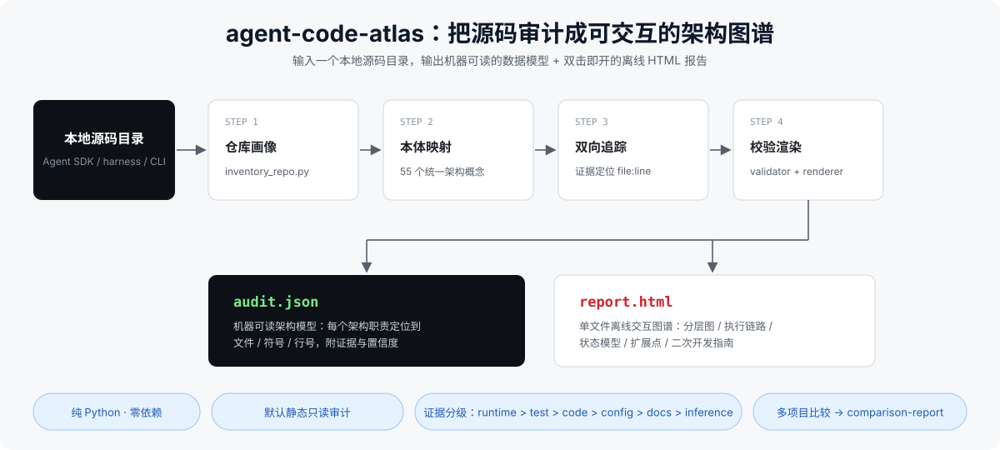

# agent-code-atlas



> 把任意 Agent SDK / Agent Harness / CLI Agent 的源码，审计成一张可交互的架构图谱。

给它一个本地 agent 项目的源码目录，它回答：这个项目是什么类型、每项架构职责（agent loop、tool registry、model provider、tool executor、context/state、permission、sandbox、事件流、memory、checkpoint、subagent、扩展点……）由哪些文件 / 类 / 函数承担、证据在哪一行、如何二次开发。

产出不是一篇 Markdown 文档，而是：

- **`audit.json`** — 机器可读的统一架构数据模型，每个结论带代码位置、证据与置信度
- **`report.html`** — 自包含单文件交互报告，双击 `file://` 离线打开，可从架构概念跳到代码位置，也可反向浏览
- 多项目比较时：**`comparison.json`** + **`comparison-report.html`**，所有项目映射到同一套架构本体概念，横向可比

## 四种工作模式

| 模式 | 输入 | 输出 |
| --- | --- | --- |
| 完整审计 | 本地仓库路径 | audit.json + report.html |
| 聚焦审计 | 仓库路径 + 专题（如 agent-loop / tool-system） | 同上，其余概念只做浅层标记 |
| 多项目比较 | 多个仓库路径或多个 audit.json | comparison.json + comparison-report.html |
| 增量刷新 | 已有 audit.json 的输出目录 | 复用仍有效的结论，标记失效证据 |

## 设计原则

- **统一本体**：跨语言、跨架构风格，把代码实体映射到 canonical 架构概念（canonical id），比较不受项目术语和目录名干扰
- **证据分级**：runtime > test > code > config > docs > inference；README 只是设计意图，不能单独证明执行路径
- **四态实现状态**：`implemented` / `delegated`（委托宿主或依赖）/ `absent`（设计上不提供）/ `unknown`，不把"委托出去"误判成"自己实现了"
- **默认静态只读**：不修改目标仓库、不安装依赖、不执行目标代码、不发网络请求；runtime 验证须用户明确授权
- **零依赖**：脚本全部使用 Python 3 标准库

## 安装

把整个目录放进 agent 客户端的 skills 目录，例如：

- ZCode：`~/.zcode/skills/agent-code-atlas/`
- Claude Code：`~/.claude/skills/agent-code-atlas/`

之后在对话里说"审计一下 xxx 框架的源码架构 / 比较这几个 agent 项目"即可触发。

## 脚本

```bash
# 仓库画像（只读扫描，不做语义判断）
python scripts/inventory_repo.py <repo-path> --out inventory.json

# 校验 audit.json / comparison.json
python scripts/validate_audit.py audit.json --strict

# 渲染自包含单文件 HTML
python scripts/render_report.py audit.json --out report.html
python scripts/render_report.py comparison.json --out comparison-report.html --mode comparison

# 端到端自检（构造样例数据跑 validator + renderer）
python scripts/smoke_test.py
```

## 目录结构

```
agent-code-atlas/
├── SKILL.md                      # 触发条件、核心约束、工作流入口
├── references/
│   ├── architecture-ontology.md  # 统一架构概念表（canonical id）
│   ├── audit-workflow.md         # 九阶段审计工作流
│   ├── audit-schema.md           # audit.json / comparison.json 数据模型
│   ├── language-strategies.md    # 各语言分析策略
│   ├── html-report-spec.md       # 报告视图与交互规范
│   └── comparison-method.md      # 多项目比较方法
├── scripts/
│   ├── inventory_repo.py         # 只读仓库画像扫描
│   ├── validate_audit.py         # 数据模型校验
│   ├── render_report.py          # 渲染自包含单文件 HTML
│   └── smoke_test.py             # 端到端自检
├── docs/                         # README 配图
└── assets/                       # 报告静态资源
```

## 已知局限

- 不做跨语言 AST：依靠仓库清单、文本搜索、符号位置、import 关系、tests 与 examples，加上语义判断
- 反射 / DI / 宏 / 动态 import / 配置驱动注册等场景会自动降级置信度
- 不声称自动证明完整调用图，也不声称不运行代码就能确认全部 runtime 行为；做不到的都如实标 `unknown`
